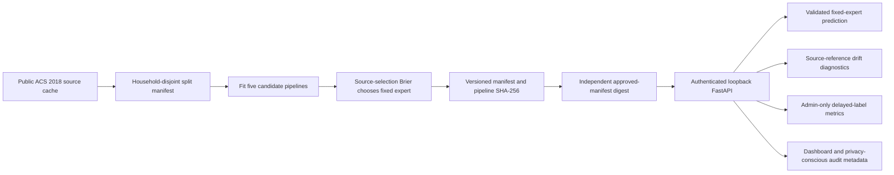

# TrustTab-X local architecture

The research-only router remains outside the serving path. The service loads only a locally trusted artifact whose digest matches an independently configured approval value. Predictions are schema-validated; operator/admin roles differ. Audit logs omit raw features, labels, probabilities and credentials. Runtime telemetry is in memory and resets on restart. The service was demonstrated locally; Docker, TLS, managed identity, retention governance and production authorization are incomplete. See [industry case study](INDUSTRIAL_CASE_STUDY.md) and [demo](LOCAL_DEMO.md).
