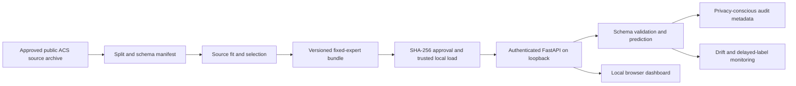

# Industrial case study: local ACSIncome reliability demonstration

## Problem and decision boundary

TrustTab-X investigates how a tabular classifier behaves when its population shifts. The bounded ACSIncome example predicts a binary income threshold using ten recorded features and a source-selected fixed expert. It is a research and local demonstration workflow, not a decision engine for a real person. The M4.2 adaptive router failed its preregistered gate and is disabled in the service.

## System and data flow

The [architecture](../../docs/M5_ARCHITECTURE.md), [API examples](../../docs/M5_API.md), [artifact/monitoring contract](../../docs/M5_MODEL_MONITORING.md), [security policy](../../docs/M5_SECURITY.md) and [Docker runbook](../../docs/M5_DOCKER.md) specify the implementation. The artifact digest must be independently approved before trusted deserialization. Local operator/admin keys govern prediction and monitoring roles. Keys are generated locally and are not committed. The dashboard retains its key in tab memory. Schema rejection, batch-mode behavior, drift diagnostics and audit IDs are covered by the existing tests and M5.1 security record.

## Demonstrated observations

The locked ACS bounded geographic result gave Brier 0.131644 on the ID test and 0.145517 on New England OOD. The M5.1 loopback run recorded 100 sequential predictions, p50/p95 21.43/37.25 ms, 49.11 requests/s, 184.29 MiB process-tree RSS and 2.267 s startup. It included one intentional rejected unauthorized probe. These are one-host smoke observations, not capacity, availability or security certifications. See [verification ledger](../../RESULTS_VERIFICATION.md) and [machine record](evidence/m5_1_security_verification.json).

## Release decision and remaining controls

Release **B: local demo only**. A Docker engine was unavailable on the checkpoint host, so container execution and Linux artifact loading remain unverified. An internal deployment needs container smoke and digest/scanning evidence, TLS, managed identity or a secure session gateway, centralized rate limits, governed audit retention/redaction/access, source-data rights and privacy review, security approval, and monitoring response ownership. Public exposure and real-world decisions are out of scope. New model-policy research requires independent preregistered families and cannot reuse the viewed target outcomes for selection.
