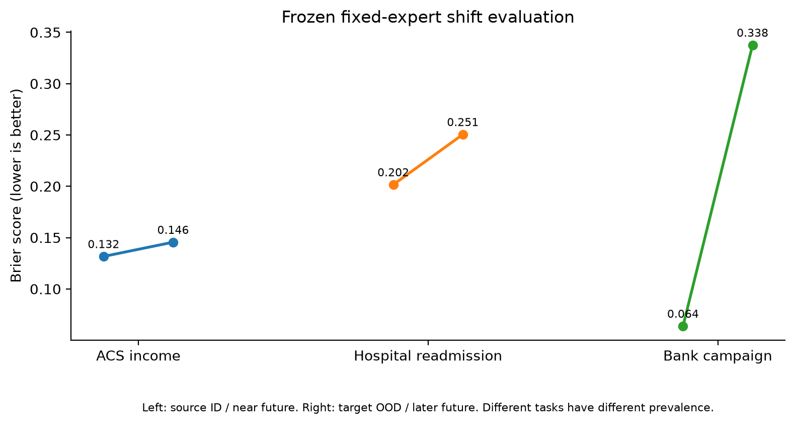
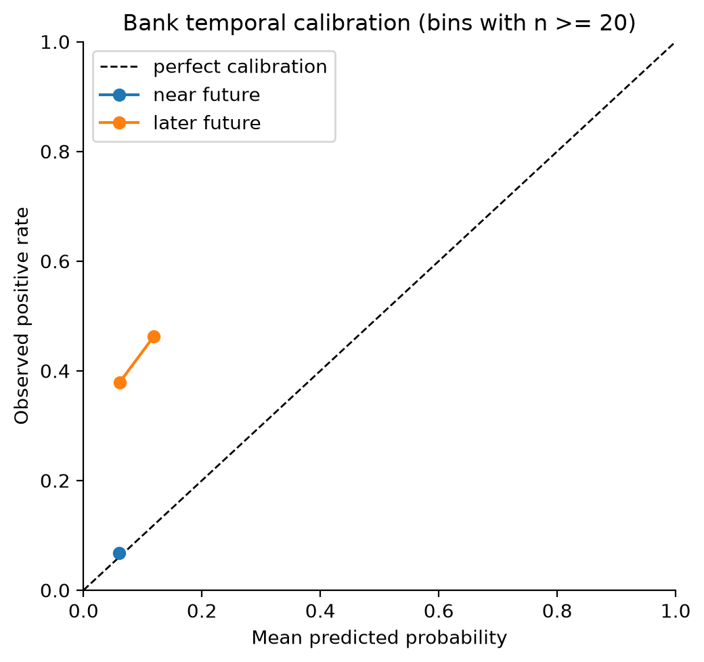
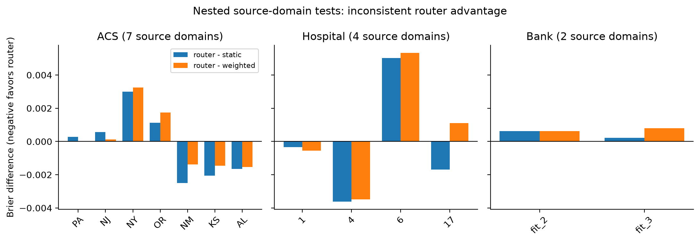
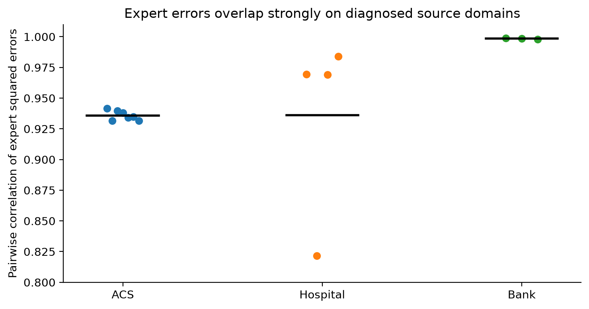
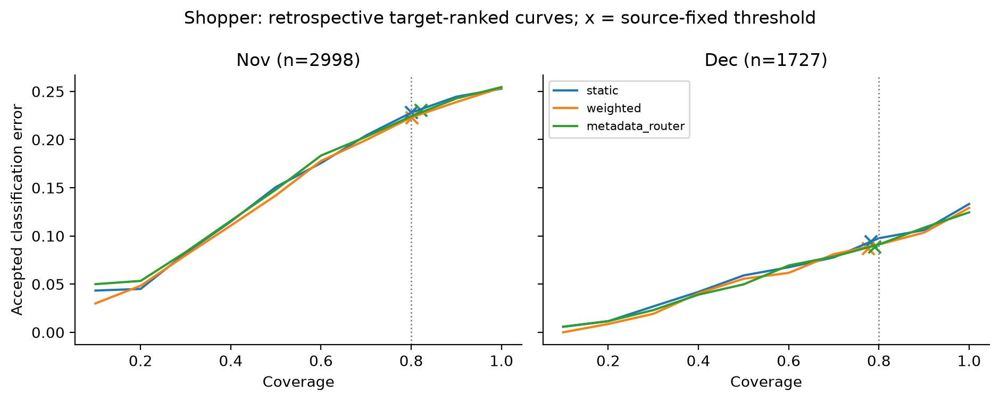
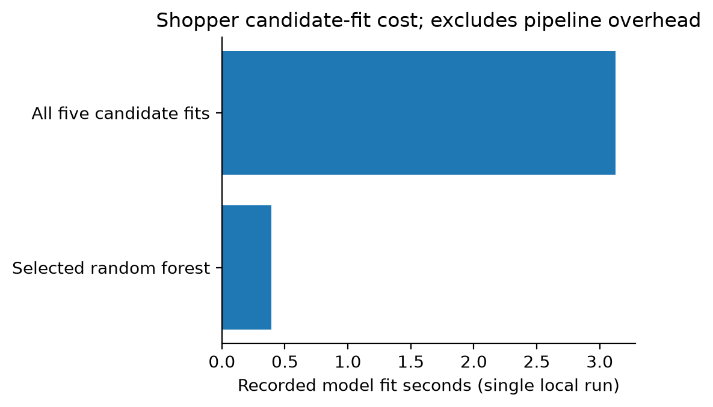

# TrustTab-X: Trustworthy Tabular Machine Learning Under Distribution Shift — Cross-Domain Evaluation, Reliability-Aware Prediction and Deployment

## Abstract

TrustTab-X evaluates classical tabular experts, ensembles and a metadata router under geographic, institutional and temporal shift. It separates model fit, selection, probability calibration, acceptance-threshold calibration and final tests. On bounded natural-shift studies, a source-selected expert's Brier score changed from 0.131644 to 0.145517 for ACS Income, 0.201603 to 0.250504 for hospital readmission and 0.063753 in a near-future bank period to 0.337574 in a later period. The bank comparison is forward-period against forward-period, not ID against OOD. A nested source-domain router beat static selection in only 6 of 13 correlated domains; a preregistered new shopper family failed its 0.002 improvement margin over a weighted ensemble. The research decision therefore retains a fixed expert. The accompanying local inference demonstration provides artifact approval, schema checks, authentication and monitoring, while production release remains blocked by governance and infrastructure gates. The contribution is an auditable negative result and reproducible evaluation boundary, not a claim of router superiority or production readiness.

## 1. Introduction and related work

Prediction quality estimated on a development population may not transport to another state, hospital population or campaign year. TrustTab-X asks whether source-selected fixed models retain probability quality under these shifts and whether an adaptive metadata router improves enough to justify extra complexity and fitting cost. Natural shift benchmarks such as [TableShift](https://proceedings.neurips.cc/paper_files/paper/2023/hash/a76a757ed479a1e6a5f8134bea492f83-Abstract-Datasets_and_Benchmarks.html) and [WILDS](https://proceedings.mlr.press/v139/koh21a.html) motivate explicit domain boundaries. Our bounded ACS and hospital studies modify upstream designs and are **not official TableShift scores**. [Folktables](https://arxiv.org/abs/2108.04884) motivates geographic and temporal ACS evaluation; the specific state partition here is ours. Calibration and shift detection have distinct failure modes ([Guo et al.](https://proceedings.mlr.press/v70/guo17a.html); [Rabanser et al.](https://proceedings.neurips.cc/paper/2019/hash/846c260d715e5b854ffad5f70a516c88-Abstract.html)).

## 2. Data and experimental design

| Family | Boundary and design | Caveat and exact evidence |
|---|---|---|
| ACS Income 2018 | Seven source states (PA, NJ, NY, OR, NM, KS, AL) and six New England target states (CT, MA, ME, NH, RI, VT); household-disjoint partitions; ten features; income above $56,000; 14,000 fit, 4,193 selection, 4,200 calibration, 4,240 ID and 18,000 OOD rows. | Bounded study, not official TableShift. [Manifest](../../docs/ACS_INCOME_DOMAIN_MANIFEST.md), [JSON](../results/acs_income_2018_geographic_expanded.json). |
| Hospital readmission | TableShift-derived, modified 17-feature study with patient-disjoint partitions and admission-code domains. | Not an official TableShift score. [Manifest](../../docs/TABLESHIFT_DOMAIN_MANIFEST.md), [JSON](../results/tableshift_diabetes_12000.json). |
| Bank campaign | Chronological source, near-future and later-future blocks; 13 pre-call features. | Customer identity and exact contact times unverified. Both reported tests are future periods. [JSON](../results/bank_temporal_2008_2010.json). |
| UCI online shoppers | New family preregistered before archive-label inspection; November 2,998 rows and December 1,727 rows. | Correlated months from one family. [Protocol](../../docs/M4_2_SOURCE_PROTOCOL.md), [JSON](../results/m4_2_shopper_confirmation.json). |
| College Scorecard | 2025 for-profit target cohort, 228 rows. | Already viewed; not reusable as fresh confirmation. [JSON](../results/college_scorecard_2025_confirmation.json). |

The [experiment protocol](../../docs/EXPERIMENT_PROTOCOL.md) and [source protocol](../../docs/M4_2_SOURCE_PROTOCOL.md) document the split rules and locked decisions. Raw records are not redistributed here. Earlier synthetic and OpenML CC18 runs establish implementation behavior, but do not replace these natural-domain evaluations.

## 3. Methods and leakage controls

For binary label \(y_i\) and probability \(p_i\), Brier score is \(n^{-1}\sum_i(p_i-y_i)^2\), with lower values preferred. Recorded secondary measures include log loss, AUROC, average precision, ten-bin expected calibration error (ECE), acceptance and selective error. ECE is descriptive and sensitive to binning and prevalence; it cannot certify subgroup calibration. Candidate experts are logistic regression, histogram gradient boosting, random forest, XGBoost and one-hot CatBoost. The selected fixed model is chosen using source selection data. In the M4.2 policy comparison, distinct source partitions fit the separately reported probability-calibrated control and the acceptance thresholds; the primary static policy uses its uncalibrated source-selected expert. Target outcomes are never used to update the reported source-fitted policy.

The M4.2 router uses comparable expert probabilities and source-derived metadata instead of merging incompatible raw feature columns. Nested outer-source-domain evaluation excludes each outer domain from inner expert fitting, selection, calibration and threshold fitting. This strengthens the source diagnostic but does not turn 13 correlated domains into 13 independent families. A separate shopper family was preregistered and evaluated once. The source-fixed threshold may miss its intended 80% target acceptance. Target-ranked risk–coverage curves are retrospective descriptions, not deployable thresholds. With only three original families, we do not report a family-level confidence interval or a population-level generalization claim.

Formally, let \(f_k(x)\) be the probability from expert \(k\), \(k=1,\ldots,5\). The static policy chooses \(k^*=\arg\min_k \widehat{\mathrm{BS}}_{\rm select}(f_k)\) on source selection rows and returns \(f_{k^*}(x)\); a separately reported calibrated-static control fits its calibrator only on source calibration rows. The weighted policy combines the five expert outputs using normalized inverse source-selection Brier scores. For the metadata router, a fixed-alpha ridge regressor \(g_k\) is fit for each expert to predict its squared error from source-held-out prediction metadata \(z(x)\). It chooses \(k_R(x)=\arg\min_k g_k(z(x))\) and returns \(p_R(x)=f_{k_R(x)}(x)\); it does **not** learn mixture weights. Its training and calibration use inner source folds; the held-out outer source domain is used only for evaluation. A confidence acceptance rule \(a_\tau(x)=\mathbf{1}[\max(p(x),1-p(x))\geq\tau]\) uses a threshold \(\tau\) chosen on source threshold-calibration rows. Target acceptance \(n^{-1}\sum_i a_\tau(x_i)\) and accepted error are then measured without retuning \(\tau\). This distinction prevents a retrospectively favorable target cutoff from masquerading as a deployment result.

## 4. Results

### 4.1 Fixed expert under natural shift

| Family | Earlier/source Brier | Target/later Brier | Additional observation |
|---|---:|---:|---|
| ACS Income | 0.131644 | 0.145517 | Target ECE 0.006536; small aggregate ECE does not establish subgroup reliability. |
| Hospital readmission | 0.201603 | 0.250504 | Target ECE 0.095313. |
| Bank campaign | 0.063753 | 0.337574 | Near/later prevalence 0.06846/0.38459; ECE 0.008141/0.319628. |

The bank prevalence change is substantial and precludes attributing all Brier degradation to conditional model failure. Reliability bins show the observed calibration pattern; the figure suppresses bins with fewer than 20 rows, without treating remaining points as precise estimates.

### 4.2 Routing decision

| Source family | Static mean Brier | Router mean Brier | Weighted mean Brier |
|---|---:|---:|---:|
| ACS | 0.141614 | 0.141437 | 0.141332 |
| Hospital | 0.189329 | 0.189170 | 0.188566 |
| Bank | 0.056951 | 0.057372 | 0.056665 |

The router beat static selection on 6/13 outer source domains. Weighted ensembles had lower family means than the router in each family. A source-fixed threshold aiming for 80% acceptance reached at least 80% on 9/13 static, 8/13 weighted and 6/13 router domains. The small, correlated differences do not support router deployment. Mean pairwise squared-error correlations of experts were about 0.936 on ACS and hospital and 0.998 on bank source domains. High overlap plausibly limits routing headroom, but is not causal proof.

The preregistered shopper family produced November static/weighted/router Brier 0.190073/0.189411/0.196618 and December 0.103842/0.102534/0.102092. December router gain over weighted was 0.000442, below the locked 0.002 margin; November was worse. December source-fixed coverage was 0.7817 for static and 0.7759 for weighted, below 0.8. Two months remain one family. The separate College Scorecard for-profit target also favored static random forest (0.263707) over router (0.285757), but those outcomes are viewed evidence and cannot be retuned on. The [M4.2 decision](../../docs/M4_2_RESEARCH_DECISION.md) is **C — no adaptive advantage demonstrated**. The fixed expert remains the supported baseline; the router is research-only.

Curves rank target rows retrospectively; crosses mark source-fixed threshold outcomes. Reading off a new target-specific cutoff would violate the locked deployment rule.

### 4.3 Cost and local engineering

The shopper single-run candidate fit times sum to 3.127 s; the selected random forest fit took 0.393 s. These exclude pipeline overhead and are not normalized hardware benchmarks. M5.1 loopback verification recorded 100 sequential HTTP predictions with p50/p95 21.43/37.25 ms, 49.11 requests/s, 184.29 MiB process-tree RSS and 2.267 s startup. An intentional unauthorized probe was rejected. These are local smoke measurements, not service-level guarantees ([record](../results/m5_1_security_verification.json)).

## 5. Limitations, ethics and decision

| Statistical limitation | Consequence for interpretation |
|---|---|
| Three original source families and one later shopper family | No precise family-level interval or broad superiority claim. |
| Seven ACS states, four hospital codes and two bank blocks share underlying systems | Domain counts are not independent dataset replicates. |
| Shopper November and December are adjacent months | Treat as one family, not two replications. |
| Source-fixed acceptance varies on target | Matched target coverage is descriptive, not an operational threshold guarantee. |
| One local compute and HTTP smoke | No reliable scale, hardware-normalized speed or service-level claim. |

Future research should register new independent natural families before outcome inspection, evaluate family-held-out transfer and subgroup calibration, and audit source feature timing and licensing. Any richer router must be compared against a fixed expert and a weighted ensemble at a matched fit and inference budget, with a deployment policy selected entirely from source environments. The next engineering work is the existing Docker and internal governance gate; another pass over viewed targets would not add independent evidence.

Household and patient disjointness reduce evident entity leakage but cannot establish absence of all proxy leakage or fairness harms. The bank archive does not verify customer recurrence or exact event time, so its temporal conclusion is bounded. Source-fixed calibration and abstention cannot guarantee performance after arbitrary shift; [conformal prediction](https://arxiv.org/abs/2107.07511) also has assumptions that should not be silently transferred to shifted targets. The results comprise only a few independent families; no family-level uncertainty interval is supported. No real lending, clinical, employment or other consequential decision should use the demo without a separate validation and governance process.

The M5.1 release decision is **B: local demo only**. A Docker runtime was unavailable for the container smoke. TLS, managed browser identity, central audit governance and source-data rights review are pending. No adaptive router or automatic abstention switch is enabled in the demo. The [industrial case study](../../docs/M6_INDUSTRIAL_CASE_STUDY.md) specifies these boundaries.

## 6. Reproducibility and conclusion

The [reproducibility guide](../../docs/M6_REPRODUCIBILITY.md) separates low-cost regeneration of figures from tracked JSON from full raw-data experiments. [Figure manifest](../figures/manifest.json) hashes the precise JSON inputs. Full reruns need the upstream public archives, documented rights and a stronger compute budget. Under the recorded natural shifts, probability quality and source-fixed acceptance transport can fail; adaptive routing did not meet its research gate. The justified current policy is the source-selected fixed expert, pending genuinely new preregistered independent families and completed production controls.

## References

1. Gardner, J., Popovic, Z., and Schmidt, L. (2023). [Benchmarking Distribution Shift in Tabular Data with TableShift](https://proceedings.neurips.cc/paper_files/paper/2023/hash/a76a757ed479a1e6a5f8134bea492f83-Abstract-Datasets_and_Benchmarks.html). NeurIPS Datasets and Benchmarks.
2. Koh, P. W., et al. (2021). [WILDS: A Benchmark of in-the-Wild Distribution Shifts](https://proceedings.mlr.press/v139/koh21a.html). ICML.
3. Guo, C., Pleiss, G., Sun, Y., and Weinberger, K. Q. (2017). [On Calibration of Modern Neural Networks](https://proceedings.mlr.press/v70/guo17a.html). ICML.
4. Rabanser, S., Günnemann, S., and Lipton, Z. C. (2019). [Failing Loudly: An Empirical Study of Methods for Detecting Dataset Shift](https://proceedings.neurips.cc/paper/2019/hash/846c260d715e5b854ffad5f70a516c88-Abstract.html). NeurIPS.
5. Ding, F., Hardt, M., Miller, J., and Schmidt, L. (2021). [Retiring Adult: New Datasets for Fair Machine Learning](https://arxiv.org/abs/2108.04884). NeurIPS.
6. Angelopoulos, A. N., and Bates, S. (2021). [A Gentle Introduction to Conformal Prediction and Distribution-Free Uncertainty Quantification](https://arxiv.org/abs/2107.07511). arXiv.
